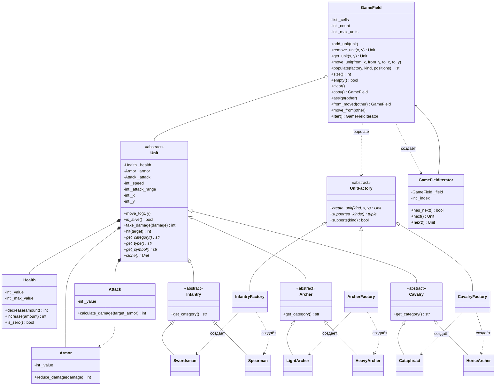

# Отчёт по лабораторной работе

**Тема:** Введение в ООП: создание классов, конструкторов классов, методов классов; наследование

**Язык:** Python 3.10+

**Репозиторий:** https://github.com/nxtchyz/mmorpg_project

## 1. Цель работы

Освоить основы ООП (классы, наследование, контейнеры) на примере игры с юнитами. Реализовать паттерн «Фабричный метод» для создания юнитов и итератор для обхода юнитов на игровом поле.

## 2. Архитектура

### 2.1. Структура проекта

```
game/
  attributes/
    health.py              Health
    armor.py               Armor
    attack.py              Attack
  units/
    unit.py                Unit (абстрактный)
    unit_kind.py           UnitKind (перечисление видов)
    infantry.py            Infantry (абстрактный)
    archer.py              Archer (абстрактный)
    cavalry.py             Cavalry (абстрактный)
    swordsman.py           Swordsman
    spearman.py            Spearman
    light_archer.py        LightArcher
    heavy_archer.py        HeavyArcher
    cataphract.py          Cataphract
    horse_archer.py        HorseArcher
  factories/
    unit_factory.py        UnitFactory (абстрактный)
    infantry_factory.py    InfantryFactory
    archer_factory.py      ArcherFactory
    cavalry_factory.py     CavalryFactory
  field/
    game_field.py          GameField
    game_field_iterator.py GameFieldIterator
main.py                    демонстрационные сценарии
```

Каждый класс лежит в отдельном модуле, модули сгруппированы в пакеты по назначению.

### 2.2. Диаграмма классов



### 2.3. Классы-атрибуты

Характеристики юнита вынесены в отдельные классы `Health`, `Armor`, `Attack`. Значение хранится в закрытом поле `_value`, снаружи доступно только для чтения через свойство `value`.

- `Health` хранит текущее и максимальное здоровье. `decrease` и `increase` не дают выйти за границы `0..max_value` и возвращают, на сколько реально изменилось здоровье. `is_zero` показывает, что юнит погиб.
- `Armor` неизменяемый. `reduce_damage(damage)` уменьшает урон на величину брони, урон не может стать отрицательным.
- `Attack` неизменяемый. `calculate_damage(target_armor)` считает итоговый урон с учётом брони цели.

Во всех конструкторах проверяется, что значение целое и неотрицательное, иначе выбрасывается `TypeError` или `ValueError`.

### 2.4. Иерархия юнитов

`Unit` — абстрактный базовый класс (`abc.ABC`). Он хранит атрибуты, координаты, скорость и дальность атаки и реализует общие методы:

- `move_to(x, y)` — перемещение не дальше скорости юнита за ход;
- `take_damage(damage)` и `hit(target)` — получение урона и атака с проверкой дальности;
- `is_alive()`, `distance_to()`, геттеры.

Абстрактные методы `get_category`, `get_type`, `get_symbol`, `clone` объявлены через `@abstractmethod`.

Три промежуточных абстрактных класса задают тип войск и его скорость: `Infantry` (скорость 2), `Archer` (скорость 2), `Cavalry` (скорость 4). Каждый реализует `get_category`, но остаётся абстрактным.

Конкретные классы задают характеристики и реализуют `get_type`, `get_symbol`, `clone`:

| Тип | Вид | Символ | Здоровье | Броня | Атака | Дальность | Скорость |
|---|---|---|---|---|---|---|---|
| Пехота | Мечник | S | 120 | 6 | 20 | 1 | 2 |
| Пехота | Копейщик | P | 110 | 5 | 17 | 2 | 2 |
| Лучники | Лёгкий лучник | L | 70 | 2 | 14 | 5 | 2 |
| Лучники | Тяжёлый лучник | H | 90 | 5 | 22 | 4 | 2 |
| Конница | Катафракт | C | 160 | 12 | 25 | 1 | 4 |
| Конница | Конный лучник | A | 100 | 4 | 16 | 4 | 4 |

`clone()` выполняется через `copy.deepcopy`, поэтому у копии собственный объект `Health` и изменения копии не влияют на оригинал.

## 3. Порождающий паттерн

Выбран **Фабричный метод**.

Абстрактный класс `UnitFactory` объявляет фабричный метод `create_unit(kind, x, y)` и метод `supported_kinds()`. Конкретные фабрики `InfantryFactory`, `ArcherFactory`, `CavalryFactory` создают юнитов своего типа войск, нужный вид передаётся через перечисление `UnitKind`. Если фабрике передать чужой вид, она выбрасывает `ValueError`.

Обоснование выбора:

- Абстрактная фабрика нужна, когда есть несколько семейств связанных объектов, которые создаются согласованно (например, «Армия Севера» и «Армия Юга» со своими версиями каждого юнита). Здесь у каждого вида юнита одна реализация, семейств нет, и вторая ось иерархии фабрик была бы лишней.
- Иерархия фабрик повторяет иерархию юнитов: одна фабрика на один тип войск. Новый вид пехоты требует изменений только в `InfantryFactory`.
- Клиентский код (`main.py`, `GameField.populate`) работает с интерфейсом `UnitFactory` и не зависит от конкретных классов юнитов. В демонстрации юниты создаются только через фабрики.

`GameField.populate(factory, kind, positions)` принимает фабрику и заполняет поле. До создания юнитов поле проверяет, что фабрика поддерживает вид, позиции не повторяются, клетки свободны и хватает лимита. Если хоть одна проверка не прошла, поле не меняется.

## 4. Игровое поле

`GameField` хранит юнитов в двумерном списке `list[list[Unit | None]]` размером `height x width` и следит за лимитом `max_units`.

Операции: `add_unit`, `remove_unit`, `get_unit`, `move_unit`, `populate`, `size`, `empty`, `is_full`, `clear`, `is_inside`, `is_free`. Ошибки разделены по смыслу: выход за границы — `IndexError`, пустая клетка — `KeyError`, занятая клетка — `ValueError`, превышение лимита — `OverflowError`.

`str(field)` выводит поле в рамке из `X`, юниты обозначены своими символами.

### 4.1. Копирование и перемещение

В Python нет конструкторов копирования и перемещения, как в C++, поэтому сделаны эквиваленты «правила пяти»:

| C++ | Python (GameField) | Поведение |
|---|---|---|
| Конструктор копирования | `copy()`, `copy.deepcopy(field)`, `copy.copy(field)` | новое поле, каждый юнит копируется через `clone()` |
| Копирующее присваивание | `assign(other)` | содержимое заменяется глубокой копией `other` |
| Конструктор перемещения | `GameField.from_moved(other)` | новое поле забирает юнитов, `other` становится пустым |
| Перемещающее присваивание | `move_from(other)` | текущее поле забирает юнитов, `other` становится пустым |
| Деструктор | сборщик мусора | отдельной реализации не требуется |

`copy.copy` тоже делает глубокую копию, чтобы два поля не могли случайно разделить одних и тех же юнитов. `assign` и `move_from` корректно обрабатывают присваивание самому себе.

### 4.2. Передача параметров

В Python объекты передаются по ссылке, поэтому при вызове методов лишних копий не создаётся. Копии делаются только там, где они нужны по смыслу: в `clone()`, `copy()` и `assign()`. При перемещении поля юниты не копируются, а передаются вместе со списком клеток. Единственное преобразование `list(positions)` в `populate` нужно, чтобы пройти по переданным позициям несколько раз (проверка, затем создание).

## 5. Итератор

`GameFieldIterator` обходит клетки поля построчно, слева направо и сверху вниз, и возвращает только непустые клетки.

- `has_next()` пропускает пустые клетки и сообщает, есть ли ещё юнит.
- `next()` возвращает текущего юнита и сдвигает позицию, при окончании выбрасывает `StopIteration`.
- `__iter__` и `__next__` реализуют протокол итератора Python, поэтому работает `for unit in field`.

`GameField.__iter__` каждый раз создаёт новый итератор. Итератор не хранит снимок поля, а читает клетки на ходу, поэтому удалять юнитов во время обхода безопасно: удалённый юнит просто не встретится дальше.

## 6. Демонстрационные сценарии

Запуск: `python main.py`.

1. **Создание поля и наполнение через фабрики** — поле 12x8 заполняется девятью юнитами через три фабрики, затем проверяются лимит, чужой вид для фабрики и выход за границы.
2. **Глубокое копирование** — у копии одному юниту наносится урон, другой удаляется, третий перемещается. Оригинал при этом не меняется, общих юнитов нет.
3. **Перемещение поля** — `from_moved` и `move_from` передают юнитов без копирования и оставляют источник пустым, `assign` делает независимую копию.
4. **Обход итератором с массовым действием** — залп по всем юнитам на поле, затем подсчёт выживших через `has_next`/`next`.
5. **Удаление во время итерации** — погибшие юниты убираются с поля прямо в цикле `for`.
6. **Бой на поле** — лучник и катафракт сражаются, катафракт подходит через `move_unit`, погибший убирается с поля.

### Вывод программы

```
=== Фабрики юнитов ===
InfantryFactory
  Пехота   | Мечник          [S]
  Пехота   | Копейщик        [P]
ArcherFactory
  Лучники  | Лёгкий лучник   [L]
  Лучники  | Тяжёлый лучник  [H]
CavalryFactory
  Конница  | Катафракт       [C]
  Конница  | Конный лучник   [A]
Ошибка: Фабрика пехоты не создаёт юнитов вида cataphract

=== 1. Создание поля и наполнение через фабрики ===
X X X X X X X X X X X X X X
X                         X
X L                       X
X   S               C     X
X H   P               A   X
X   S                     X
X L                 C     X
X                         X
X                         X
X X X X X X X X X X X X X X
Юнитов на поле: 9 из 10
Добавлен ещё один конный лучник, поле заполнено: True
Ошибка: Не хватит места: свободно 0, нужно 1
Ошибка: Фабрика ArcherFactory не создаёт юнитов вида cataphract
Ошибка: Клетка (20, 20) за пределами поля 12x8

=== 2. Глубокое копирование поля ===
Оригинал:
X X X X X X X X X X X X X X
X                         X
X L                       X
X   S               C     X
X H   P               A   X
X   S                     X
X L                 C     X
X                         X
X                         X
X X X X X X X X X X X X X X
Копия после изменений:
X X X X X X X X X X X X X X
X                         X
X L                       X
X   S         C           X
X H   P               A   X
X   S                     X
X L                       X
X                         X
X                         X
X X X X X X X X X X X X X X
Юнитов в оригинале: 9, в копии: 8
Мечник (1, 2) в оригинале: 120 HP
Мечник (1, 2) в копии:     20 HP
Есть общие юниты: False
copy.deepcopy тоже даёт независимую копию: True

=== 3. Перемещение поля (передача владения) ===
from_moved: в новом поле 9 юнитов, старое пустое: True
Юниты не копировались, а перешли: True
move_from: поле стало 12x8, юнитов 9, источник пустой: True
assign: у копии 8 юнитов, у исходного поля осталось 9

=== 4. Обход итератором: массовое действие ===
Залп по всему полю силой 75:
  Лёгкий лучник   (0, 1)   -70 HP, осталось 0
  Мечник          (1, 2)   -69 HP, осталось 51
  Катафракт       (9, 2)   -63 HP, осталось 97
  Тяжёлый лучник  (0, 3)   -70 HP, осталось 20
  Копейщик        (2, 3)   -70 HP, осталось 40
  Конный лучник   (10, 3)  -71 HP, осталось 29
  Мечник          (1, 4)   -69 HP, осталось 51
  Лёгкий лучник   (0, 5)   -70 HP, осталось 0
  Катафракт       (9, 5)   -63 HP, осталось 97
Выживших (подсчёт через has_next/next): 7 из 9

=== 5. Удаление во время итерации ===
  Убран погибший: Лёгкий лучник (0, 1)
  Убран погибший: Лёгкий лучник (0, 5)
X X X X X X X X X X X X X X
X                         X
X                         X
X   S               C     X
X H   P               A   X
X   S                     X
X                   C     X
X                         X
X                         X
X X X X X X X X X X X X X X
Осталось юнитов: 7

=== 6. Бой на поле ===
X X X X X X X X X X X X
X                     X
X                     X
X   L             C   X
X                     X
X                     X
X X X X X X X X X X X X
Ход 1: Катафракт скачет на (4, 2)
Ход 2: Лёгкий лучник стреляет, урон 2
Ход 2: Катафракт скачет на (2, 2)
Ход 3: Лёгкий лучник стреляет, урон 2
Ход 3: Катафракт атакует, урон 23
Ход 4: Лёгкий лучник стреляет, урон 2
Ход 4: Катафракт атакует, урон 23
Ход 5: Лёгкий лучник стреляет, урон 2
Ход 5: Катафракт атакует, урон 23
Ход 6: Лёгкий лучник стреляет, урон 2
Ход 6: Катафракт атакует, урон 1
X X X X X X X X X X X X
X                     X
X                     X
X     C               X
X                     X
X                     X
X X X X X X X X X X X X
Победитель: Катафракт [C] (2, 2) HP 150/160 ARM 12 ATK 25
Ошибка: Катафракт не может пройти больше 4 клеток за ход
```

## 7. Листинги ключевых файлов

### `game/attributes/health.py`

```python
class Health:
    def __init__(self, value: int, max_value: int | None = None) -> None:
        if max_value is None:
            max_value = value
        if not isinstance(value, int) or not isinstance(max_value, int):
            raise TypeError("Здоровье должно быть целым числом")
        if max_value <= 0:
            raise ValueError("Максимальное здоровье должно быть положительным")
        if not 0 <= value <= max_value:
            raise ValueError("Здоровье должно быть в диапазоне от 0 до максимального")
        self._value = value
        self._max_value = max_value

    @property
    def value(self) -> int:
        return self._value

    @property
    def max_value(self) -> int:
        return self._max_value

    def decrease(self, amount: int) -> int:
        self._check_amount(amount)
        lost = min(amount, self._value)
        self._value -= lost
        return lost

    def increase(self, amount: int) -> int:
        self._check_amount(amount)
        restored = min(amount, self._max_value - self._value)
        self._value += restored
        return restored

    def is_zero(self) -> bool:
        return self._value == 0

    @staticmethod
    def _check_amount(amount: int) -> None:
        if not isinstance(amount, int):
            raise TypeError("Величина изменения здоровья должна быть целым числом")
        if amount < 0:
            raise ValueError("Величина изменения здоровья не может быть отрицательной")

    def __repr__(self) -> str:
        return f"Health({self._value}/{self._max_value})"
```

### `game/units/unit.py`

```python
from abc import ABC, abstractmethod

from game.attributes.armor import Armor
from game.attributes.attack import Attack
from game.attributes.health import Health


class Unit(ABC):
    def __init__(
        self,
        health: Health,
        armor: Armor,
        attack: Attack,
        speed: int,
        attack_range: int,
        x: int = 0,
        y: int = 0,
    ) -> None:
        if speed <= 0:
            raise ValueError("Скорость юнита должна быть положительной")
        if attack_range <= 0:
            raise ValueError("Дальность атаки должна быть положительной")
        self._check_coordinates(x, y)
        self._health = health
        self._armor = armor
        self._attack = attack
        self._speed = speed
        self._attack_range = attack_range
        self._x = x
        self._y = y

    @property
    def health(self) -> Health:
        return self._health

    @property
    def armor(self) -> Armor:
        return self._armor

    @property
    def attack(self) -> Attack:
        return self._attack

    @property
    def speed(self) -> int:
        return self._speed

    @property
    def attack_range(self) -> int:
        return self._attack_range

    @property
    def x(self) -> int:
        return self._x

    @property
    def y(self) -> int:
        return self._y

    @property
    def position(self) -> tuple[int, int]:
        return self._x, self._y

    def distance_to(self, x: int, y: int) -> int:
        return max(abs(self._x - x), abs(self._y - y))

    def can_reach(self, x: int, y: int) -> bool:
        return self.distance_to(x, y) <= self._speed

    def move_to(self, x: int, y: int) -> None:
        self._check_coordinates(x, y)
        if not self.is_alive():
            raise ValueError(f"{self.get_type()} погиб и не может перемещаться")
        if not self.can_reach(x, y):
            raise ValueError(f"{self.get_type()} не может пройти больше {self._speed} клеток за ход")
        self._x = x
        self._y = y

    def is_alive(self) -> bool:
        return not self._health.is_zero()

    def take_damage(self, damage: int) -> int:
        if damage < 0:
            raise ValueError("Урон не может быть отрицательным")
        return self._health.decrease(damage)

    def hit(self, target: "Unit") -> int:
        if target is self:
            raise ValueError("Юнит не может атаковать сам себя")
        if not self.is_alive():
            raise ValueError(f"{self.get_type()} погиб и не может атаковать")
        if not target.is_alive():
            raise ValueError(f"{target.get_type()} уже погиб")
        if self.distance_to(target.x, target.y) > self._attack_range:
            raise ValueError(f"{target.get_type()} вне дальности атаки")
        damage = self._attack.calculate_damage(target.armor)
        return target.take_damage(damage)

    @staticmethod
    def _check_coordinates(x: int, y: int) -> None:
        if x < 0 or y < 0:
            raise ValueError("Координаты юнита не могут быть отрицательными")

    @abstractmethod
    def get_category(self) -> str:
        ...

    @abstractmethod
    def get_type(self) -> str:
        ...

    @abstractmethod
    def get_symbol(self) -> str:
        ...

    @abstractmethod
    def clone(self) -> "Unit":
        ...

    def __str__(self) -> str:
        return (
            f"{self.get_type()} [{self.get_symbol()}] ({self._x}, {self._y}) "
            f"HP {self._health.value}/{self._health.max_value} "
            f"ARM {self._armor.value} ATK {self._attack.value}"
        )
```

### `game/units/infantry.py`

```python
from game.attributes.armor import Armor
from game.attributes.attack import Attack
from game.attributes.health import Health
from game.units.unit import Unit


class Infantry(Unit):
    SPEED = 2

    def __init__(
        self,
        health: Health,
        armor: Armor,
        attack: Attack,
        attack_range: int = 1,
        x: int = 0,
        y: int = 0,
    ) -> None:
        super().__init__(health, armor, attack, self.SPEED, attack_range, x, y)

    def get_category(self) -> str:
        return "Пехота"
```

### `game/units/swordsman.py`

```python
from copy import deepcopy

from game.attributes.armor import Armor
from game.attributes.attack import Attack
from game.attributes.health import Health
from game.units.infantry import Infantry


class Swordsman(Infantry):
    def __init__(self, x: int = 0, y: int = 0) -> None:
        super().__init__(Health(120), Armor(6), Attack(20), attack_range=1, x=x, y=y)

    def get_type(self) -> str:
        return "Мечник"

    def get_symbol(self) -> str:
        return "S"

    def clone(self) -> "Swordsman":
        return deepcopy(self)
```

### `game/factories/unit_factory.py`

```python
from abc import ABC, abstractmethod

from game.units.unit import Unit
from game.units.unit_kind import UnitKind


class UnitFactory(ABC):
    @abstractmethod
    def create_unit(self, kind: UnitKind, x: int = 0, y: int = 0) -> Unit:
        ...

    @abstractmethod
    def supported_kinds(self) -> tuple[UnitKind, ...]:
        ...

    def supports(self, kind: UnitKind) -> bool:
        return kind in self.supported_kinds()
```

### `game/factories/infantry_factory.py`

```python
from game.factories.unit_factory import UnitFactory
from game.units.spearman import Spearman
from game.units.swordsman import Swordsman
from game.units.unit import Unit
from game.units.unit_kind import UnitKind


class InfantryFactory(UnitFactory):
    def create_unit(self, kind: UnitKind, x: int = 0, y: int = 0) -> Unit:
        match kind:
            case UnitKind.SWORDSMAN:
                return Swordsman(x, y)
            case UnitKind.SPEARMAN:
                return Spearman(x, y)
        raise ValueError(f"Фабрика пехоты не создаёт юнитов вида {kind.value}")

    def supported_kinds(self) -> tuple[UnitKind, ...]:
        return UnitKind.SWORDSMAN, UnitKind.SPEARMAN
```

### `game/field/game_field.py`

```python
from collections.abc import Iterable

from game.factories.unit_factory import UnitFactory
from game.field.game_field_iterator import GameFieldIterator
from game.units.unit import Unit
from game.units.unit_kind import UnitKind


class GameField:
    def __init__(self, width: int, height: int, max_units: int) -> None:
        if width <= 0 or height <= 0:
            raise ValueError("Размеры поля должны быть положительными")
        if not 0 < max_units <= width * height:
            raise ValueError("Лимит юнитов должен быть от 1 до количества клеток поля")
        self._width = width
        self._height = height
        self._max_units = max_units
        self._cells = self._empty_cells(width, height)
        self._count = 0

    @classmethod
    def from_moved(cls, other: "GameField") -> "GameField":
        field = cls(other.width, other.height, other.max_units)
        field.move_from(other)
        return field

    @property
    def width(self) -> int:
        return self._width

    @property
    def height(self) -> int:
        return self._height

    @property
    def max_units(self) -> int:
        return self._max_units

    def is_inside(self, x: int, y: int) -> bool:
        return 0 <= x < self._width and 0 <= y < self._height

    def is_free(self, x: int, y: int) -> bool:
        return self.is_inside(x, y) and self._cells[y][x] is None

    def is_full(self) -> bool:
        return self._count >= self._max_units

    def add_unit(self, unit: Unit) -> None:
        x, y = unit.position
        self._check_inside(x, y)
        if not self.is_free(x, y):
            raise ValueError(f"Клетка ({x}, {y}) уже занята")
        if self.is_full():
            raise OverflowError(f"На поле уже максимум юнитов: {self._max_units}")
        self._cells[y][x] = unit
        self._count += 1

    def populate(
        self,
        factory: UnitFactory,
        kind: UnitKind,
        positions: Iterable[tuple[int, int]],
    ) -> list[Unit]:
        if not factory.supports(kind):
            raise ValueError(f"Фабрика {type(factory).__name__} не создаёт юнитов вида {kind.value}")
        positions = list(positions)
        if len(set(positions)) != len(positions):
            raise ValueError("Позиции для размещения повторяются")
        if self._count + len(positions) > self._max_units:
            raise OverflowError(f"Не хватит места: свободно {self._max_units - self._count}, нужно {len(positions)}")
        for x, y in positions:
            if not self.is_free(x, y):
                raise ValueError(f"Клетка ({x}, {y}) занята или за пределами поля")
        units = [factory.create_unit(kind, x, y) for x, y in positions]
        for unit in units:
            self.add_unit(unit)
        return units

    def remove_unit(self, x: int, y: int) -> Unit:
        unit = self.get_unit(x, y)
        if unit is None:
            raise KeyError(f"На клетке ({x}, {y}) нет юнита")
        self._cells[y][x] = None
        self._count -= 1
        return unit

    def get_unit(self, x: int, y: int) -> Unit | None:
        self._check_inside(x, y)
        return self._cells[y][x]

    def move_unit(self, from_x: int, from_y: int, to_x: int, to_y: int) -> None:
        unit = self.get_unit(from_x, from_y)
        if unit is None:
            raise KeyError(f"На клетке ({from_x}, {from_y}) нет юнита")
        self._check_inside(to_x, to_y)
        if not self.is_free(to_x, to_y):
            raise ValueError(f"Клетка ({to_x}, {to_y}) уже занята")
        unit.move_to(to_x, to_y)
        self._cells[from_y][from_x] = None
        self._cells[to_y][to_x] = unit

    def size(self) -> int:
        return self._count

    def empty(self) -> bool:
        return self._count == 0

    def clear(self) -> None:
        self._cells = self._empty_cells(self._width, self._height)
        self._count = 0

    def copy(self) -> "GameField":
        field = GameField(self._width, self._height, self._max_units)
        for unit in self:
            field.add_unit(unit.clone())
        return field

    def assign(self, other: "GameField") -> None:
        if other is self:
            return
        self.move_from(other.copy())

    def move_from(self, other: "GameField") -> None:
        if other is self:
            return
        self._width = other._width
        self._height = other._height
        self._max_units = other._max_units
        self._cells = other._cells
        self._count = other._count
        other._cells = self._empty_cells(other._width, other._height)
        other._count = 0

    def _check_inside(self, x: int, y: int) -> None:
        if not self.is_inside(x, y):
            raise IndexError(f"Клетка ({x}, {y}) за пределами поля {self._width}x{self._height}")

    @staticmethod
    def _empty_cells(width: int, height: int) -> list[list[Unit | None]]:
        return [[None] * width for _ in range(height)]

    def __copy__(self) -> "GameField":
        return self.copy()

    def __deepcopy__(self, memo: dict) -> "GameField":
        field = self.copy()
        memo[id(self)] = field
        return field

    def __iter__(self) -> GameFieldIterator:
        return GameFieldIterator(self)

    def __len__(self) -> int:
        return self.size()

    def __str__(self) -> str:
        border = " ".join("X" * (self._width + 2))
        rows = [border]
        for row in self._cells:
            cells = " ".join(" " if unit is None else unit.get_symbol() for unit in row)
            rows.append(f"X {cells} X")
        rows.append(border)
        return "\n".join(rows)
```

### `game/field/game_field_iterator.py`

```python
from typing import TYPE_CHECKING

from game.units.unit import Unit

if TYPE_CHECKING:
    from game.field.game_field import GameField


class GameFieldIterator:
    def __init__(self, field: "GameField") -> None:
        self._field = field
        self._index = 0

    def has_next(self) -> bool:
        total = self._field.width * self._field.height
        while self._index < total:
            if self._field.get_unit(*self._current_cell()) is not None:
                return True
            self._index += 1
        return False

    def next(self) -> Unit:
        if not self.has_next():
            raise StopIteration
        unit = self._field.get_unit(*self._current_cell())
        self._index += 1
        return unit

    def _current_cell(self) -> tuple[int, int]:
        return self._index % self._field.width, self._index // self._field.width

    def __iter__(self) -> "GameFieldIterator":
        return self

    def __next__(self) -> Unit:
        return self.next()
```

## 8. Соответствие критериям оценки

| № | Требование | Баллы | Где выполнено |
|---|---|---|---|
| 1 | Основные требования класса поля | 15 | `game/field/game_field.py`: произвольный размер, лимит юнитов, добавление, удаление и перемещение по координатам |
| 2 | Основные требования классов юнитов | 15 | `game/units/`: абстрактный `Unit`, 3 типа по 2 вида, здоровье, броня, атака, скорость, дальность, перемещение |
| 3 | Программа разбита на файлы | 5 | каждый класс в отдельном модуле, пакеты `attributes`, `units`, `factories`, `field` |
| 4 | Конструкторы копирования и перемещения | 15 | `GameField.copy`, `__deepcopy__`, `__copy__`, `assign`, `from_moved`, `move_from`; сценарии 2 и 3 |
| 5 | Классы для атрибутов юнитов | 15 | `Health`, `Armor`, `Attack` в `game/attributes/` с валидацией |
| 6 | Паттерн «Фабричный метод» | 25 | `UnitFactory` и три конкретные фабрики в `game/factories/`, `GameField.populate`, обоснование в разделе 3 |
| 7 | Итератор для поля | 10 | `game/field/game_field_iterator.py`; сценарии 4 и 5 |
| | **Итого** | **100** | |
